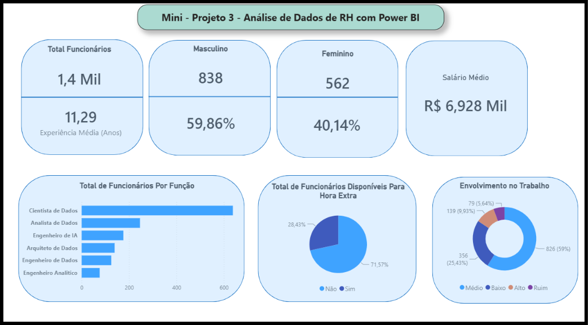

# 📊 Análise de Dados de RH (People Analytics) — Power BI

Dashboard interativo desenvolvido para análise de indicadores de Recursos Humanos, permitindo acompanhar a volumetria de colaboradores, distribuição demográfica, faixa salarial, disponibilidade para horas extras e nível de engajamento no trabalho.

## 🖼️ Visualização do Dashboard

## 🎯 Principais Indicadores (KPIs) e Análises
* **Visão Geral:** Total de 1,4 mil funcionários, com tempo médio de experiência de 11,29 anos e salário médio de R$ 6,928 mil[cite: 2].
* **Distribuição por Género:** Proporção de 59,86% (838) colaboradores do sexo masculino e 40,14% (562) do sexo feminino[cite: 2].
* **Distribuição por Função:** Maior concentração de profissionais atuando como Cientista de Dados e Analista de Dados[cite: 2].
* **Horas Extras e Engajamento:** Mapeamento da disponibilidade para horas extras (28,43% disponíveis) e análise do nível de envolvimento no trabalho (59% em nível médio)[cite: 2].

## 🛠️ Ferramentas e Técnicas Utilizadas
* **Power BI Desktop:** Tratamento e limpeza de dados (ETL) no Power Query, modelagem e criação de medidas DAX.
* **Visualização de Dados:** Construção de cartões de KPIs, gráficos de barras, rosca e pizza com foco em clareza executiva[cite: 2].

## 📂 Como visualizar o projeto
1. Faça o download do arquivo `dashboard-rh.pbix` disponível neste repositório.
2. Abra o arquivo utilizando o **Power BI Desktop**.
